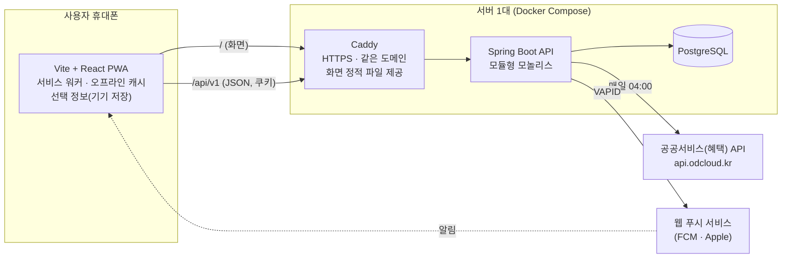
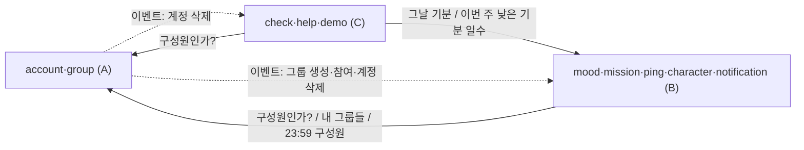
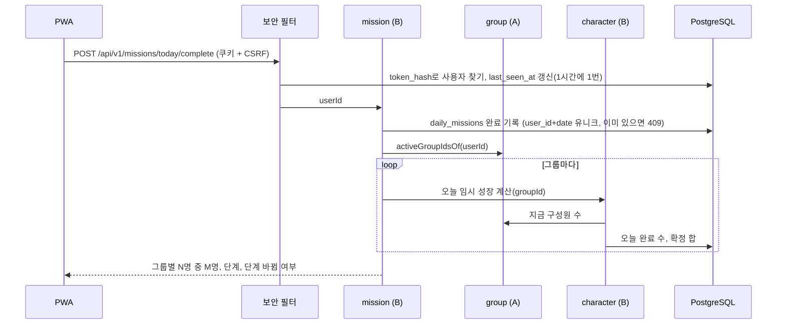

# 행운핑 아키텍처 (MVP)

- 2026년 11월 16일 작성 · @고은우
- 요구사항: [prd.md](prd.md) · API: [api.md](api.md) · 데이터: [erd.md](erd.md) · 화면: [UserFlow.md](UserFlow.md)
- 배포 방식(4절)은 **제안**이다. 대회 환경이 정해지면 고친다.

## 1. 한눈에 보기



**원칙**

1. 서버는 하나의 Spring Boot 앱이다(모듈형 모놀리스). 3명이 나눠 만들지만 배포는 하나다.
2. 화면과 API는 **같은 도메인**에서 나간다. 쿠키를 SameSite=Lax로 쓸 수 있고 CORS 설정이 필요 없다.
3. 외부 API는 전부 백엔드만 부른다. 키가 기기로 가지 않는다.
4. 도움받기 필터는 기기에서 한다. 생년월일·지역·하는 일은 서버로 가지 않는다.
5. 성장·완료 현황·점검 결과는 서버만 계산한다.
6. 미션 배정·문구·도움 연결은 모두 규칙 기반이다. 외부 AI(LLM)는 쓰지 않는다(이유는 [decisions.md](decisions.md) D-06).

## 2. 백엔드 모듈 구조

### 2.1 패키지

```
com.haengunping
├─ common        공용: 시계(Clock), 에러 응답, 보안 설정, 요청 횟수 제한, job_runs
├─ account   (A) 익명 계정, 세션 쿠키, 동의, 계정 삭제
├─ group     (A) 그룹, 구성원, 초대 코드, 온라인 대기열, 차단·신고, 미접속 정리
├─ mood      (B) 기분, 가벼운 도움 카드
├─ mission   (B) 주제, 오늘 미션, 시작·완료
├─ ping      (B) 핑
├─ character (B) 캐릭터, 확정 처리, 도감
├─ notification (B) 웹 푸시 구독·발송, 알림 설정
├─ check     (C) 주간 점검
├─ help      (C) 도움받을 곳 목록, 순서 신호, 공공서비스 동기화
└─ demo      (C) 시연 시계 (demo 프로필에서만 빈으로 등록)
```

각 모듈 안은 같은 모양으로 나눈다.

```
group
├─ api            컨트롤러, 요청·응답 DTO (외부에 보이는 형태)
├─ application    서비스 (트랜잭션 경계)
├─ domain         엔티티, 규칙(값 객체·계산)
├─ infra          리포지토리, 외부 API 클라이언트
└─ GroupQuery.java  다른 모듈에 여는 인터페이스 (이것만 public)
```

### 2.2 모듈 사이 규칙

- 다른 모듈의 `domain`·`infra`를 직접 쓰지 않는다. 다른 모듈의 **공개 인터페이스**만 부른다.
- 다른 모듈의 테이블에 SQL로 직접 쓰지 않는다. 읽기도 공개 인터페이스로 한다.
- 이 규칙은 ArchUnit 테스트 하나로 막는다(`..group.domain..`은 `group` 밖에서 쓰지 못함 등).

**공개 인터페이스 (첫날 정함, prd.md 10절)**



- **그룹 → 캐릭터:** 그룹이 만들어질 때 A가 B를 직접 부르면 서로 의존하게 된다. 그래서 A는 `GroupCreatedEvent`를 발행하고 B가 받아 첫 캐릭터를 만든다(Spring `ApplicationEventPublisher`, 같은 트랜잭션 안 `@TransactionalEventListener(BEFORE_COMMIT)`).
- 같은 방식으로 A는 `MemberJoinedEvent`·`AccountDeletedEvent`를 발행하고, B·C는 자기 데이터를 정리한다.

### 2.3 요청 한 건의 흐름 (미션 완료)



## 3. 정해진 시각에 도는 작업

| 시각(KST) | 작업 | 모듈 | 겹침 방지 |
| --- | --- | --- | --- |
| 00:00 | 밀린 날짜의 확정 성장 계산 → 캐릭터 완성·새 캐릭터 | character | `job_runs(FINALIZE_PROGRESS, 날짜)` |
| 00:10 | 온라인 그룹 7일 미접속 구성원 내보내기 → 대기열 배정 | group | `job_runs(REMOVE_INACTIVE, 날짜)` |
| 04:00 | 공공서비스 API 동기화 | help | `job_runs(SYNC_SERVICES, 날짜)` |
| 매 1분 | 온라인 대기열 배정 | group | 그룹 행 잠금 |
| 매 30분 | 미션 알림 | notification | 보낸 기록(날짜) |
| 일 18:00 | 점검 알림 | notification | 보낸 기록(주) |

- `@Scheduled(zone = "Asia/Seoul")`로 돌린다. 서버가 1대라 분산 잠금은 쓰지 않는다.
- 확정 처리는 **00:10 내보내기보다 먼저** 끝나야 한다. 내보내기 작업은 시작할 때 그날 `FINALIZE_PROGRESS`가 `DONE`인지 확인하고, 아니면 먼저 확정 처리를 부른다.
- 시연 시계를 바꾸면(`PUT /demo/clock`) 확정 처리를 바로 한 번 부른다.

## 4. 배포 (제안)

| 항목 | 안 |
| --- | --- |
| 서버 | 클라우드 VM 1대(2 vCPU, 4GB) |
| 실행 | Docker Compose: `proxy`(Caddy + 프론트 `dist`), `api`(Spring Boot, Java 21), `db`(PostgreSQL 16) |
| 프록시 | Caddy. HTTPS 인증서 자동 발급, `/api/*` → api, 나머지 → 프론트 정적 파일(없는 경로는 `index.html`) |
| 환경 | 프로필 `local`, `demo`. 시연 서버는 `demo`(시연 시계·시드 켜짐). `local`만 쿠키 `Secure`를 끌 수 있다(사파리는 http에서 Secure 쿠키를 저장하지 않음) |
| 비밀값 | `.env`를 Compose가 읽음. 저장소에는 `.env.example`만 |
| DB 백업 | 시연 전날 `pg_dump` 1회, 시드로 언제든 다시 만들 수 있게 함 |
| CI | GitHub Actions: 빌드 → 테스트(Testcontainers PostgreSQL) → JaCoCo 커버리지 → gitleaks → 의존성 취약점 검사. Dependabot 주 1회 |

### 4.1 서버를 늘릴 때 (MVP 밖)

MVP는 서버 1대를 가정해 단순하게 만들었다. 사용자가 늘면 아래만 바꾸면 된다. 도메인 코드는 그대로다.

| 지금(1대) | 늘릴 때 | 바뀌는 곳 |
| --- | --- | --- |
| `@Scheduled` + `job_runs`로 중복 방지 | ShedLock(DB 잠금)으로 한 대만 실행 | `common` 스케줄 설정 |
| Bucket4j 메모리 버킷 | Bucket4j + Redis | `common` 요청 제한 설정 |
| 세션 토큰 해시를 DB에서 조회 | 그대로(상태 없는 API라 여러 대 가능) | 없음 |
| VM 1대, PostgreSQL 같은 VM | 관리형 PostgreSQL, API 2대 이상 + 로드밸런서 | 배포 설정 |
| 도움받기 목록 매 요청 DB 조회 | `ETag` 그대로, 앞단 CDN 캐시 | 프록시 설정 |

운영 비용은 VM 1대(월 수만 원)와 도메인뿐이다. 외부 유료 API(LLM 등)를 쓰지 않아 사용자가 늘어도 호출 비용이 늘지 않는다. 공공서비스 API는 무료이고 하루 1번만 부른다.

**HTTPS가 꼭 필요한 이유:** PWA 설치, 서비스 워커, 웹 푸시, `Secure` 쿠키가 모두 HTTPS에서만 동작한다.

## 5. 프론트(PWA)와 맞물리는 부분

프론트 구현은 이 문서 범위 밖이지만, 백엔드와 약속해야 하는 것만 적는다.

| 항목 | 약속 |
| --- | --- |
| 오프라인 | 서비스 워커가 `GET /api/v1/help/items`를 캐시(stale-while-revalidate, `ETag`). 도움받기 화면 자체도 미리 캐시 |
| 선택 정보 | 생년월일·지역·하는 일은 기기 저장소(IndexedDB)에만. 어떤 요청에도 실어 보내지 않음 |
| 팝업 판단 | 기분 팝업은 `GET /me`의 `today`와 기기에 저장한 날짜로 판단 |
| CSRF | `XSRF-TOKEN` 쿠키 값을 `X-XSRF-TOKEN` 헤더로. 쿠키는 서버가 모든 응답(첫 `GET /me`의 401 포함)에 심는다 |
| 시각 표시 | 서버는 UTC, 화면은 KST로 바꿔 표시 |

## 6. 보안 구성

| 층 | 무엇을 | PRD |
| --- | --- | --- |
| 전송 | HTTPS 전용, HSTS | — |
| 인증 | 세션 토큰 쿠키(HttpOnly·Secure·SameSite=Lax), 서버는 SHA-256 해시만 저장, 커스텀 `OncePerRequestFilter` | ACC-01, 02 |
| CSRF | Spring Security `CookieCsrfTokenRepository.withHttpOnlyFalse()` + `CsrfTokenRequestAttributeHandler`(SPA 방식, 쿠키 값을 그대로 헤더로 받음). 기본값은 토큰을 늦게 만들어 첫 `POST /accounts` 전에 쿠키가 없으므로, 응답마다 토큰을 읽어 `XSRF-TOKEN` 쿠키를 심는 필터를 둔다 | SEC-04 |
| 에러 응답 | 시큐리티 단계 거절도 `{code, message}`로: `AuthenticationEntryPoint` → 401 `UNAUTHENTICATED`, `AccessDeniedHandler` → 403 `CSRF_INVALID`. 기본값(빈 본문)으로 두지 않음 | — |
| 인가 | 서비스 계층에서 `GroupQuery.findActiveMember`로 검사, 실패 시 404. 기분·점검은 `userId` 조건으로만 조회 | SEC-02, 03 |
| 입력 | Bean Validation(`@Valid`), 열거값은 Java `enum`으로 받음 | SEC-05 |
| DB | Spring Data JPA, 파라미터 바인딩만 | SEC-06 |
| 출력 | JSON만 응답, 프론트 이스케이프, CSP 헤더(프록시에서) | SEC-07 |
| 요청 횟수 | Bucket4j 메모리 버킷(서버 1대): 계정 생성 IP당 10/시, 초대 참여 20/시, 신고 사용자당 10/일 | SEC-08 |
| 비밀값 | `.env`, gitleaks | SEC-10 |
| 로그 | 요청 로그에서 쿠키·`answers`·`mood` 값 가림(로그 마스킹 필터) | SEC-11 |
| 민감정보 저장 | 디스크 암호화된 볼륨. 컬럼 단위 암호화는 MVP에서 하지 않음(남은 위험에 기록) | — |
| 예외 응답 | `@RestControllerAdvice` 하나에서 모든 예외를 `{code, message}`로 바꿈. 예상 밖 예외는 500 `INTERNAL_ERROR`로 답하고 서버 로그에만 원인을 남김(로그 마스킹 적용) | SEC-12 |
| 시연 시계 | `demo` 프로필 + 시드 시연 계정(`users.is_demo`)만. 아니면 404로 숨김. 화면의 시연 도구도 `isDemo`일 때만 보임 | SEC-13 |
| AI 코드·의존성 | PR마다 AI 사용 여부와 검증 방법 체크(PR 템플릿), 버전 잠금, CI 취약점 검사 | SEC-14 |

## 7. 장애 시 동작

| 장애 | 동작 |
| --- | --- |
| 공공서비스 API 실패 | 이전 값 유지, `syncedAt`은 마지막 성공 시각 |
| 웹 푸시 실패 | 무시, 410이면 구독 삭제 |
| 서버 다운 | 도움받기 탭은 캐시로 열림, 다른 화면은 "연결되면 갱신돼요" |
| 확정 처리 실패 | `job_runs`에 `FAILED`, 다음 실행 때 밀린 날짜로 다시 처리 |

## 8. 테스트 구성

| 종류 | 도구 | 무엇을 |
| --- | --- | --- |
| 단위 | JUnit 5 | 성장 계산, 낮은 기분 연속, 점검 판정, 미션 크기·주제 배정 (prd.md 6절 경계값 표 그대로) |
| 통합 | Spring Boot Test + Testcontainers(PostgreSQL) | API 전체, 권한(SEC-01~03), 동시 참여 6명 제한 |
| 구조 | ArchUnit | 모듈 사이 규칙(2.2절), `LocalDate.now()` 직접 호출 금지(DEMO-02) |
| 보안 | 통합 테스트 + gitleaks | SEC-01~13 |
| 의존성 | Gradle 의존성 잠금 + OSV-Scanner로 잠금 파일 전체 검사(push·PR·주 1회, 취약점 하나라도 있으면 실패) + Dependabot 주 1회 | SEC-14 |
| 커버리지 | JaCoCo. 도메인 규칙 패키지(`*.domain`) 줄 커버리지 80% 미만이면 CI 실패 | — |

- 테스트 이름에 PRD ID를 붙인다. 예: `CHR02_완료한_구성원이_23시에_나가면_분모와_분자에서_빠진다`.
- 모든 날짜 계산 테스트는 고정 `Clock`을 주입한다.
