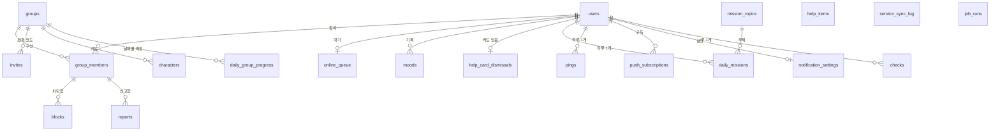

# 행운핑 ERD (MVP)

- 2026년 11월 16일 작성 · @고은우
- 요구사항: [prd.md](prd.md) · API: [api.md](api.md) · 구조: [architecture.md](architecture.md)
- DB: PostgreSQL 16. 모든 시각은 `timestamptz`(UTC), 날짜는 KST 기준 `date`.
- 테이블 이름 앞의 **A/B/C**는 담당이다. 담당자만 그 테이블에 쓴다.

## 1. 전체 관계

`help_items`·`service_sync_log`·`job_runs`는 사용자와 관계가 없는 독립 테이블이다.

## 2. 담당 A — 계정·그룹

### `users`

| 컬럼 | 타입 | 제약 | 설명 |
| --- | --- | --- | --- |
| id | bigint | PK, identity | |
| nickname | varchar(10) | null 허용 | 계정 삭제 시 null |
| token_hash | bytea | unique, null 허용 | 세션 토큰 SHA-256(32바이트). 삭제 시 null |
| adult_confirmed | boolean | not null, default false | 만 19세 이상 자기 확인 |
| sensitive_consent_at | timestamptz | null 허용 | 민감정보 동의 시각, 철회하면 null |
| last_seen_at | timestamptz | not null | 7일 미접속 판단 |
| is_demo | boolean | not null, default false | 시연 계정 |
| created_at | timestamptz | not null | |
| deleted_at | timestamptz | null 허용 | 계정 삭제 시각 |

- 계정 삭제는 행을 지우지 않고 `nickname`·`token_hash`를 비운다. 그룹 구성원 이력(`group_members`)의 외래 키를 지키기 위해서다.

### `groups`

| 컬럼 | 타입 | 제약 | 설명 |
| --- | --- | --- | --- |
| id | bigint | PK | |
| type | varchar(10) | check in (`FRIEND`,`ONLINE`,`SOLO`) | |
| name | varchar(12) | not null | 온라인은 이름 목록에서 무작위 |
| is_demo | boolean | not null, default false | |
| created_at | timestamptz | not null | |
| archived_at | timestamptz | null 허용 | 마지막 구성원이 나가면 |

### `group_members`

| 컬럼 | 타입 | 제약 | 설명 |
| --- | --- | --- | --- |
| id | bigint | PK | API의 `memberId` |
| group_id | bigint | FK → groups | |
| user_id | bigint | FK → users | API 응답에 내보내지 않음 |
| display_name | varchar(20) | not null | 온라인: 랜덤 별칭, 친구: 닉네임 복사 |
| joined_at | timestamptz | not null | |
| left_at | timestamptz | null 허용 | null이면 현재 구성원 |
| left_reason | varchar(20) | check in (`LEFT`,`INACTIVE`,`REPORTED`,`ACCOUNT_DELETED`) | |

| 인덱스 | 용도 |
| --- | --- |
| unique (group_id, user_id) where left_at is null | 한 그룹에 중복 참여 금지 |
| unique (group_id, display_name) where left_at is null | 그룹 안 별칭 중복 금지 |
| (user_id) where left_at is null | 내 그룹 목록, 그룹 3개 제한 |
| (group_id, joined_at, left_at) | 23:59 시점 구성원 계산 |

- 23:59 시점 구성원: `joined_at <= 그날 23:59:59 KST` 이고 (`left_at` is null 또는 `left_at > 그날 23:59:59 KST`).
- 나갔다가 다시 들어오면 새 행을 만든다(새 `memberId`, 새 별칭).

### `invites`

| 컬럼 | 타입 | 제약 | 설명 |
| --- | --- | --- | --- |
| id | bigint | PK | |
| group_id | bigint | FK → groups | |
| code | char(8) | unique | 영문 대문자·숫자(0·O·1·I 제외) |
| created_by_member_id | bigint | FK → group_members | |
| expires_at | timestamptz | not null | 만든 뒤 7일 |
| revoked_at | timestamptz | null 허용 | 새 코드를 만들면 이전 코드에 기록 |

### `online_queue`

| 컬럼 | 타입 | 제약 | 설명 |
| --- | --- | --- | --- |
| user_id | bigint | PK, FK → users | 한 사람당 1자리 |
| queued_at | timestamptz | not null | 먼저 온 순서로 배정 |

### `blocks`

| 컬럼 | 타입 | 제약 | 설명 |
| --- | --- | --- | --- |
| blocker_member_id | bigint | PK(1), FK → group_members | |
| blocked_member_id | bigint | PK(2), FK → group_members | |
| created_at | timestamptz | not null | |

- 같은 그룹 구성원끼리만 만들 수 있다(서비스에서 검사). check (blocker ≠ blocked).

### `reports`

| 컬럼 | 타입 | 제약 | 설명 |
| --- | --- | --- | --- |
| id | bigint | PK | |
| group_id | bigint | FK → groups | |
| reporter_member_id | bigint | FK → group_members | |
| target_member_id | bigint | FK → group_members | |
| reason | varchar(12) | check in (`SPAM`,`HARASSMENT`,`OTHER`) | |
| created_at | timestamptz | not null | |

- unique (reporter_member_id, target_member_id): 같은 대상 중복 신고는 1건.

## 3. 담당 B — 기분·미션·핑·캐릭터·알림

### `moods` (민감정보)

| 컬럼 | 타입 | 제약 | 설명 |
| --- | --- | --- | --- |
| user_id | bigint | PK(1), FK → users | |
| date | date | PK(2) | KST |
| mood | varchar(10) | check in (`GOOD`,`CALM`,`OKAY`,`TIRED`,`DEPRESSED`,`LONELY`) | |
| updated_at | timestamptz | not null | 같은 날 덮어쓰기 |

### `help_card_dismissals`

| 컬럼 | 타입 | 제약 | 설명 |
| --- | --- | --- | --- |
| user_id | bigint | PK, FK → users | |
| dismissed_at | timestamptz | not null | 7일 동안 카드 숨김 |

### `mission_topics` (시드 20행)

| 컬럼 | 타입 | 제약 | 설명 |
| --- | --- | --- | --- |
| id | smallint | PK | 기획서 목록 번호 |
| category | varchar(20) | not null | `ACTIVITY`, `STRETCH`, `NATURE_SUN`, `WEAK_TIE`, `KINDNESS`, `BREATH`, `MINDFUL`, `PLEASURE`, `MASTERY`, `GOOD_THING` |
| outdoor_text | varchar(60) | not null | |
| indoor_text | varchar(60) | not null | |
| size_type | varchar(5) | check in (`TIME`,`COUNT`) | |
| count_sizes | smallint[3] | null 허용 | `COUNT`일 때 5·10·20분에 대응하는 횟수(예: {1,2,4}) |
| priority_moods | varchar(10)[] | not null | 먼저 주는 기분 |

### `daily_missions`

| 컬럼 | 타입 | 제약 | 설명 |
| --- | --- | --- | --- |
| user_id | bigint | PK(1), FK → users | |
| date | date | PK(2) | 하루 1개 |
| topic_id | smallint | FK → mission_topics | 배정 후 바뀌지 않음 |
| minutes | smallint | check in (5,10,20), null 허용 | 시작 때 고른 시간 |
| size | smallint | null 허용 | 분 또는 횟수 |
| place | varchar(7) | check in (`OUTDOOR`,`INDOOR`), null 허용 | |
| started_at | timestamptz | null 허용 | |
| completed_at | timestamptz | null 허용 | 한 번 쓰면 바꾸지 않음 |

| 인덱스 | 용도 |
| --- | --- |
| (date) where completed_at is not null | 그날 완료자 집계 |
| (user_id, date desc) | 최근 3일 주제 제외, 어제 고른 값 |

### `pings`

| 컬럼 | 타입 | 제약 | 설명 |
| --- | --- | --- | --- |
| user_id | bigint | PK(1), FK → users | |
| date | date | PK(2) | 하루 1개 |
| emoji | varchar(6) | check in (`CLAP`,`CLOVER`,`MUSCLE`,`SUN`) | |
| created_at | timestamptz | not null | 응답에는 내보내지 않음 |

- 그룹별 핑 목록은 '그날 그 그룹 구성원이었던 사용자의 핑'으로 구한다. 핑은 그룹마다 복사하지 않는다.

### `characters`

| 컬럼 | 타입 | 제약 | 설명 |
| --- | --- | --- | --- |
| id | bigint | PK | |
| group_id | bigint | FK → groups | |
| kind | varchar(20) | not null | 캐릭터 종류(디자이너 확정 전 임시 3종) |
| started_on | date | not null | 이 날부터의 확정 성장을 더한다 |
| completed_on | date | null 허용 | 완성된 날, null이면 진행 중 |

- unique (group_id) where completed_on is null: 그룹마다 진행 중 캐릭터 1개.
- 진행도 = `daily_group_progress`에서 `date >= started_on` 인 행들의 성장 합(완성된 캐릭터는 `date <= completed_on`까지). 진행도 컬럼을 따로 두지 않는다(CHR-04).

### `daily_group_progress`

| 컬럼 | 타입 | 제약 | 설명 |
| --- | --- | --- | --- |
| group_id | bigint | PK(1), FK → groups | |
| date | date | PK(2) | |
| member_count | smallint | check (1~6) | 23:59 시점 구성원 수 |
| completed_count | smallint | check (0 ≤ completed_count ≤ member_count) | 그중 완료한 수 |
| finalized_at | timestamptz | not null | 00:00 처리 시각 |

- 하루 성장 = 2 × completed_count ÷ member_count. 합계는 `numeric`으로 계산해 소수 오차를 피한다.
- 오늘 행은 없다. 오늘 임시 성장은 `group_members`와 `daily_missions`로 그때그때 계산한다.
- 구성원이 0명인 날(보관된 그룹)은 행을 만들지 않는다.

### `push_subscriptions`

| 컬럼 | 타입 | 제약 | 설명 |
| --- | --- | --- | --- |
| id | bigint | PK | |
| user_id | bigint | FK → users | |
| endpoint | text | unique | |
| p256dh | varchar(100) | not null | |
| auth | varchar(50) | not null | |
| created_at | timestamptz | not null | |

### `notification_settings`

| 컬럼 | 타입 | 제약 | 설명 |
| --- | --- | --- | --- |
| user_id | bigint | PK, FK → users | |
| mission_reminder_time | time | null 허용 | 30분 단위, null이면 끔 |
| weekly_check_reminder | boolean | not null, default true | |

## 4. 담당 C — 점검·도움받기·운영

### `checks` (민감정보)

| 컬럼 | 타입 | 제약 | 설명 |
| --- | --- | --- | --- |
| id | bigint | PK | |
| user_id | bigint | FK → users | |
| week_start | date | not null | 그 주 월요일 |
| status | varchar(10) | check in (`DONE`,`DISMISSED`) | |
| answers | smallint[4] | null 허용, 각 0~3 | `DISMISSED`면 null |
| result_codes | varchar(15)[] | null 허용 | `DEPRESSION`,`ANXIETY`,`LOW_MOOD_DAYS`,`STABLE` |
| created_at | timestamptz | not null | |

- unique (user_id, week_start): 한 주에 1건(제출 또는 닫기).

### `help_items`

| 컬럼 | 타입 | 제약 | 설명 |
| --- | --- | --- | --- |
| id | varchar(40) | PK | 예: `crisis-109`, `center-seoul-mapo` |
| section | varchar(12) | check in (`CRISIS_24H`,`COUNSELING`,`DROP_IN`) | |
| kind | varchar(15) | check in (`CHANNEL`,`SERVICE`,`LOCAL_CENTER`,`CENTER_FINDER`) | |
| name | varchar(60) | not null | |
| summary | varchar(120) | null 허용 | 카드에 함께 쓰는 말 |
| target | varchar(120) | null 허용 | 대상 설명(상세 화면) |
| note | varchar(200) | null 허용 | 함께 보여줄 주의 문구(예: 바우처 의뢰서 안내) |
| phone | varchar(20) | null 허용 | |
| url | text | null 허용 | |
| address | varchar(120) | null 허용 | 센터 |
| apply_method | varchar(120) | null 허용 | API 동기화 |
| deadline | varchar(60) | null 허용 | API 동기화 |
| rules | jsonb | not null, default '{}' | `minAge`,`maxAge`,`sido`,`sigungu`,`jobs` |
| source_service_id | varchar(20) | null 허용 | 공공서비스 API 서비스 ID |
| sort_order | smallint | not null | 구역 안 기본 순서 |
| synced_at | timestamptz | null 허용 | 마지막 동기화 성공 |
| updated_at | timestamptz | not null | |

- 24시간 채널·학교 상담센터·서울 25개 구 센터·센터 찾기는 시드로 넣고, `source_service_id`가 있는 행만 매일 동기화로 갱신한다.
- 시드는 마이그레이션 `V202611171101__seed_help_items.sql`. id·문구는 프론트 목업과 같다. 서울 구 센터 25행은 동기화로 덮어쓰지 않도록 `source_service_id`를 비운다.

### `service_sync_log`

| 컬럼 | 타입 | 제약 | 설명 |
| --- | --- | --- | --- |
| id | bigint | PK | |
| started_at | timestamptz | not null | |
| finished_at | timestamptz | null 허용 | |
| status | varchar(10) | check in (`RUNNING`,`SUCCESS`,`FAILED`) | |
| updated_count | integer | null 허용 | |
| error | text | null 허용 | API 키·응답 원문은 남기지 않음 |

### `job_runs` (공용, 담당 C가 만들고 A·B가 씀)

| 컬럼 | 타입 | 제약 | 설명 |
| --- | --- | --- | --- |
| job_name | varchar(30) | PK(1) | `FINALIZE_PROGRESS`, `REMOVE_INACTIVE`, `SYNC_SERVICES` |
| run_key | date | PK(2) | 처리 대상 날짜 |
| status | varchar(10) | check in (`RUNNING`,`DONE`,`FAILED`) | |
| started_at / finished_at | timestamptz | | |

- 같은 날짜를 두 번 처리하지 않게 하고(NFR-03), 밀린 날짜를 찾는 데 쓴다(CHR-03).

## 5. 삭제 규칙

| 상황 | 지우는 것 | 남기는 것 |
| --- | --- | --- |
| 기분·점검 기록 삭제 (ACC-07) | `moods`, `checks` | 나머지 |
| 민감정보 동의 철회 (ACC-06) | 없음(이후 저장만 막음) | 기존 기록 |
| 계정 삭제 (ACC-08) | `moods`, `checks`, `daily_missions`, `pings`, `push_subscriptions`, `notification_settings`, `help_card_dismissals`, `online_queue`. `users.nickname`·`token_hash` 비움 | `users` 행, `group_members`(`left_reason=ACCOUNT_DELETED`), `daily_group_progress`, `characters` |
| 그룹 나가기 (GRP-11) | 없음 | `group_members.left_at` 기록 |

- 계정 삭제 시 오늘 완료가 사라지므로, 그 그룹의 오늘 임시 성장도 함께 줄어든다(확정된 과거는 그대로).

## 6. 마이그레이션

- Flyway로 관리한다. 파일 이름은 작성 시각을 버전으로 쓴다: `V202611161030__a_create_groups.sql`(뒤에 담당 a·b·c). 세 명이 동시에 만들어도 번호가 겹치지 않는다.
- 다른 사람이 더 이른 시각의 파일을 나중에 합치면 Flyway가 거부하므로, 개발·시연 DB에서는 `spring.flyway.out-of-order=true`를 켠다.
- 한 번 합친 마이그레이션 파일은 고치지 않는다. 바꿀 일이 있으면 새 파일을 만든다.
- 시드는 `R__seed_*.sql`(반복 실행), 시연 시드는 `demo` 프로필에서만 실행한다.
